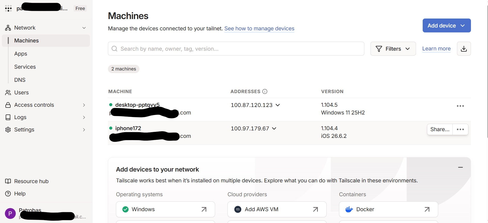
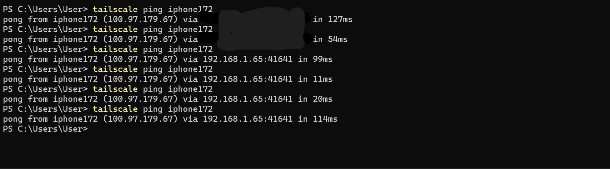
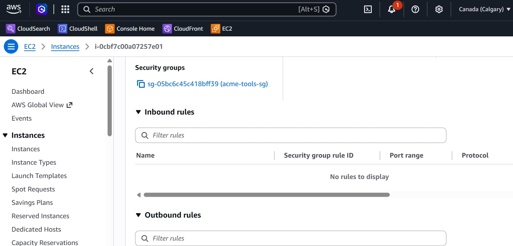
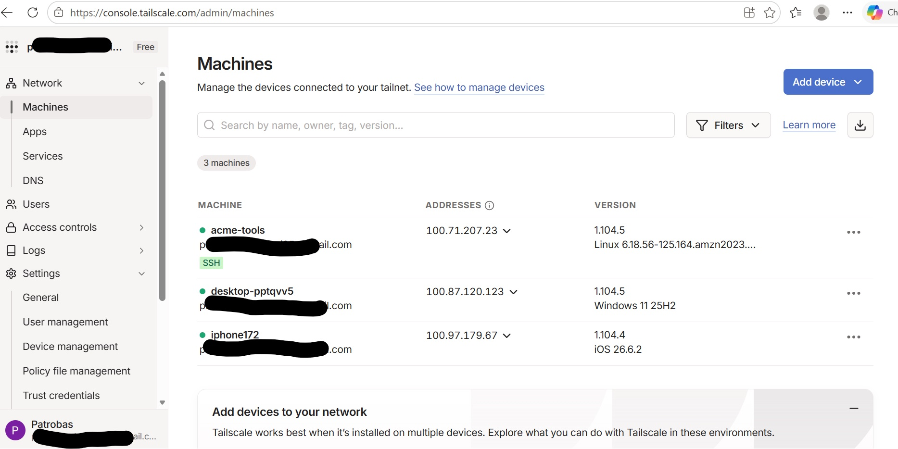
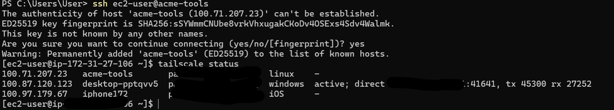
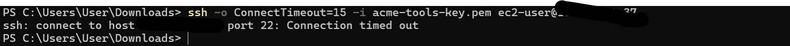

# Tailscale Onboarding Lab

A hands on lab where I onboard a pretend company, Acme, onto Tailscale the way a real customer would, starting with private access to a server on AWS.

## Why I built this

I wanted to use Tailscale, not just read about it. So I set it up end to end, broke it a few times, and fixed it. Each phase adds something a real customer would ask for.

## Phase 1: Private access to AWS (done)

**Goal:** SSH into a server on AWS without opening any ports to the internet.

**What I set up**
* A tailnet with my laptop and phone
* An EC2 instance (Amazon Linux 2023, t3.micro) in Canada West (Calgary)
* A security group with zero inbound rules
* A user data script that installs Tailscale and joins the tailnet on first boot with a single use auth key

**Results**
* SSH over Tailscale works
* SSH to the server's public IP times out, even with the correct key
* The server and my laptop connect directly, with no ports opened on either side

### How it works, in plain terms

The server never accepts connections from the internet. It reaches out to the tailnet instead. When two devices need to talk, both reach out at the same time, and each firewall treats the other side's traffic as a reply to its own request. That's NAT traversal. If a direct path can't be found, Tailscale falls back to a relay.

I saw this on my own network. Pings from my laptop to my phone first went through my home's public address (54 to 127ms), then switched by themselves to the local wifi path (as low as 11ms).

### What went wrong

See [TROUBLESHOOTING.md](TROUBLESHOOTING.md).

## What's next

* **Phase 2:** Run a small dashboard in Docker and share it only inside the tailnet
* **Phase 3:** Move it to Kubernetes with the Tailscale operator
* **Phase 4:** Access rules as code, kept in GitHub and deployed with GitHub Actions
* **Phase 5:** Break things on purpose and document the fixes
* **Phase 6:** Customer docs: onboarding guide, FAQ, runbook and a QBR summary

## Notes

* No auth keys are stored in this repo.
* Emails and public IPs are blurred in the screenshots.
