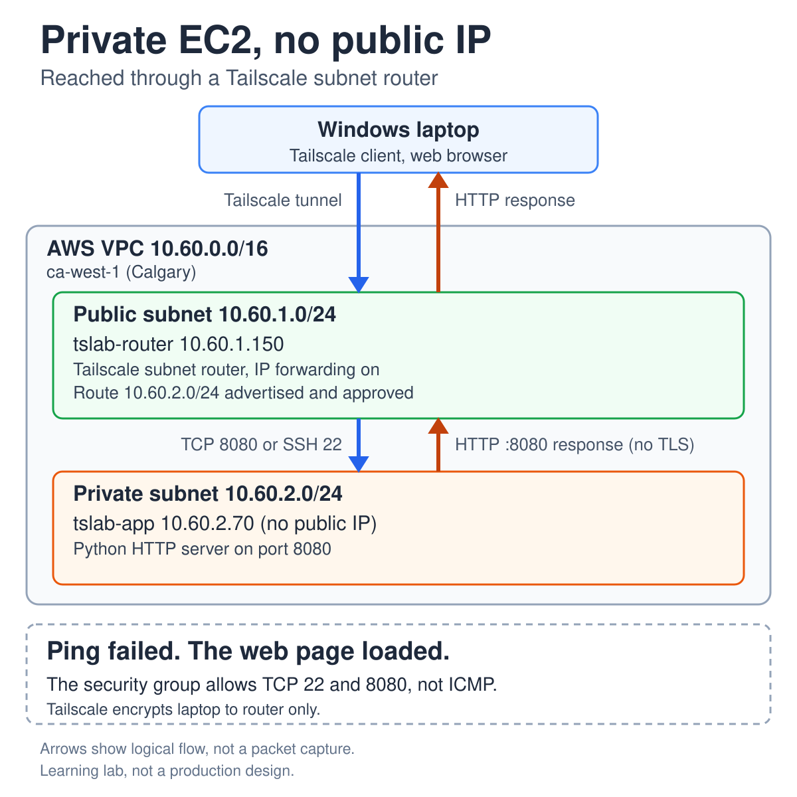
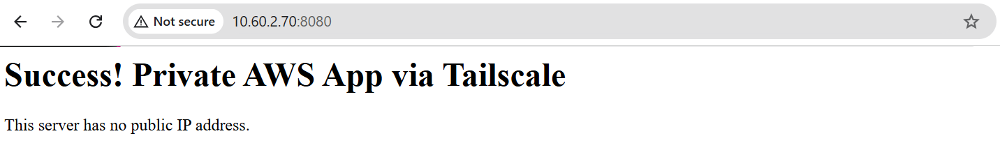
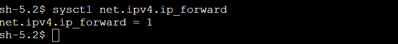

# Private AWS application access via Tailscale

A small hands on networking lab: reach an HTTP service on a private EC2 instance with no public IPv4 address, from a Windows laptop, using a Tailscale subnet router in the same VPC.

## What worked

* Windows installed a route for `10.60.2.0/24` through Tailscale.
* Windows reached the router with `tailscale ping`, first through a DERP relay and then over a direct UDP connection.
* The router connected to the app on TCP 22.
* `Test-NetConnection 10.60.2.70 -Port 22` from Windows succeeded, with `Tailscale` as the interface.
* SSH login to the private instance succeeded with a key stored on my laptop.
* A Python HTTP server on `10.60.2.70:8080` served a page that loaded in my Windows browser.

## Architecture

| Component | Configuration |
|---|---|
| AWS region | `ca-west-1` (Calgary) |
| VPC | `10.60.0.0/16` |
| Public subnet | `10.60.1.0/24`, route to an internet gateway |
| Private subnet | `10.60.2.0/24`, VPC local route only, no default route |
| Subnet router | `tslab-router`, `10.60.1.150`, Tailscale `100.80.101.20` |
| Private application | `tslab-app`, `10.60.2.70`, no public IPv4 |
| Subnet route | `10.60.2.0/24`, advertised and approved |
| Router IPv4 forwarding | Enabled (`net.ipv4.ip_forward = 1`) |
| Router source/destination check | Disabled |
| App security group | TCP 22 and TCP 8080 from the router security group only |
| Router security group | No inbound rules |

The router sits in the public subnet and the app sits in the private subnet. There is no NAT gateway. This is a learning lab, not a production design.

I disabled the source/destination check on the router as a precaution for forwarded traffic. Tailscale subnet routers translate the source address by default, so the check may not have been needed. I did not test the lab with it enabled.

## A troubleshooting lesson

Pinging the private app from the router showed 100% packet loss. The app security group allows TCP 22 and 8080 but not ICMP. Instead of assuming the network path was broken, I tested a port the security group does allow. TCP 22 connected, SSH login worked, and the web page loaded. A failed ping did not mean a failed path, it meant ICMP was not permitted.

## Validation

See [docs/validation.md](docs/validation.md) for the commands and what I observed. It describes what I tested, and it is not a one click deployment script.

## Evidence

The page loaded in Chrome on my Windows laptop from the private address:

Router terminal check that IPv4 forwarding is enabled:

## Security notes

* The app has no public IP, and its inbound rules only allow the router security group.
* The router has no inbound security group rules and was managed with AWS Systems Manager Session Manager.
* The page is plain HTTP, not HTTPS. Tailscale encrypts the laptop to router connection, but the router to app hop is not encrypted.
* The Python web server is a temporary test service.
* No private keys, auth keys, session IDs or AWS account numbers are in this repo.

## Not tested

* Packet captures. A working connection is not proof of the exact address translation, so I make no claim about it.
* Whether IPv4 forwarding survives a reboot. The setting was saved in a sysctl file, but I did not reboot to confirm.
* Failure of the router. This lab has a single router and no redundancy.
